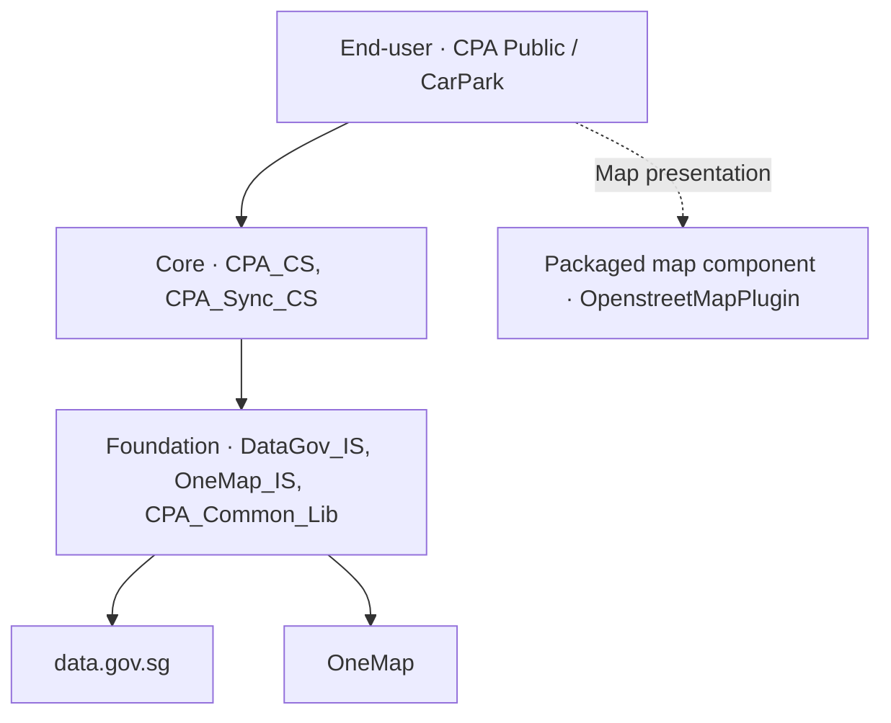

# CarParkSolution V1 architecture

The V1 export groups the application into End-user, Core, and Foundation responsibilities. This view uses the module names found in the export. The arrows show intended responsibility boundaries at layer level.

| Component | Role in the design |
| --- | --- |
| `CarPark` | Public user experience for exploring availability |
| `CPA_CS` | Core car park services used by the application |
| `CPA_Sync_CS` | Data synchronisation |
| `DataGov_IS` | data.gov.sg integration boundary |
| `OneMap_IS` | OneMap integration boundary |
| `CPA_Common_Lib` | Shared foundation code |
| `OpenstreetMapPlugin` | Packaged map presentation dependency |

The original diagram contains both MVP and future design boxes. Its labels `CPA_Public` and `Common_Lib` refer to `CPA Public` / `CarPark` and `CPA_Common_Lib` in the V1 export. `MasterData_CS`, `Audits_CS`, and `CPA_Theme` have no separate module in this package. `CPA_Admin`, `CPA_Widgets`, `Security_Lib`, `Logger_Lib`, and `Identity_IS` appear as future scope in the supplied diagram. The diagram identifies OSM tiles as an external dependency. Confirm the tile request path in the running app before documenting which component sends those requests. [Original three-layer diagram](carpark_three_layer_architecture_clean.png)

## Review walkthrough

Trace one availability update from the REST method in `DataGov_IS` through `CPA_Sync_CS` and `CPA_CS` to the `CarPark` screen. In the live environment, identify how the solution distinguishes zero lots, missing availability, and outdated readings. This walkthrough also lets reviewers see where the application handles upstream integration errors.
